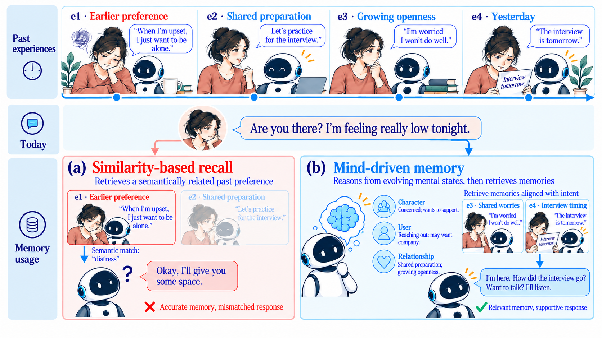
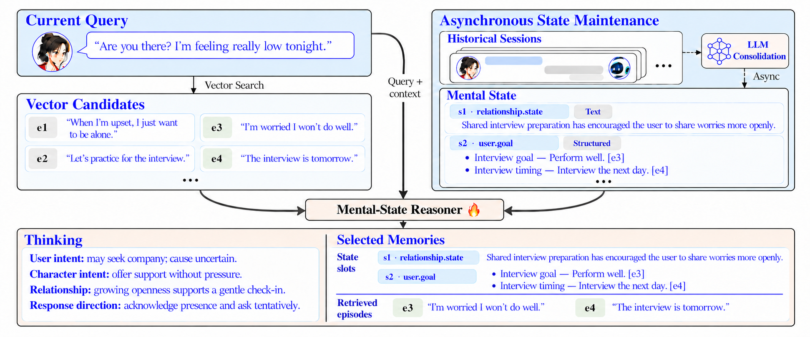

# We Are What We Remember: Mental-State-Driven Memory for Long-Term Character Dialogue

**MindMem · MemReal-Bench**

Official project repository for *We Are What We Remember: Mental-State-Driven Memory for Long-Term Character Dialogue*.

**Zhicheng Jia\*, Shuchen Wu\*, Zhuoshi Tong\*, Haisen Liao, Sicheng Zhou**

Livo Team, Kuaikan World · China Agricultural University · University of Chinese Academy of Sciences · Nanyang Technological University

\* Equal contribution.

[Overview](#overview) · [Method](#method) · [MemReal-Bench](#memreal-bench) · [Results](#results) · [Release Plan](#release-plan)

## News

- **2026-11-11:** Project repository launched with an overview, method figures, and reported experimental results. Code and MemReal-Bench will be publicly released upon acceptance.

## Overview

Long-term conversational memory is not only about recalling past facts. In character dialogue, shared experiences should also inform present conversational choices: when to offer support, how much interpersonal distance to maintain, and which character principles or world rules apply.

**MindMem** is a mental-state-driven memory framework inspired by the Self-Memory System in cognitive psychology. It asynchronously consolidates shared experiences into source-linked states of the character, the user, and their relationship. At each turn, a specialized reasoner, **Mind**, interprets the current interaction, forms a tentative response intention, and selects states and episodic evidence for response generation.

*An earlier preference for solitude may not determine what a user needs now. MindMem uses evolving states and supporting episodes to guide a tentative, context-sensitive response rather than treating an inferred need as a fact.*

## Method

MindMem separates background state consolidation from online reasoning:

1. **Asynchronous state consolidation.** An LLM consolidator maintains 40 state dimensions across seven families: user, avatar, role, relationship, emotional event, collective, and storyworld. Entries preserve their source links, attribution, and temporal scope.
2. **Mental-state-guided recall.** Dense retrieval supplies episodic candidates. Mind reads the current context, character specification, accessible states, and candidates, then jointly produces a Thinking trace, selected state entries, and selected episodic candidates.
3. **Source-linked evidence recovery.** The retrieval pipeline resolves the selected states' provenance links. This provides an access path to episodes that may be absent from the initial vector candidates.
4. **Response generation.** A fixed generator uses the Thinking guidance, selected states, and assembled episodes to produce a response. Temporal cutoffs, character visibility, and real-user/avatar attribution constrain accessible information.

Only the compact Mind reasoner is trained. Supervised initialization on 2,000 examples is followed by Group Relative Policy Optimization (GRPO), combining format validity, selection accuracy, and downstream response-quality rewards. Consolidation, dense retrieval, and the response generator remain fixed.

## MemReal-Bench

**MemReal-Bench** evaluates the distinction between *knowing* historical facts and naturally *using* them in long-term character dialogue across dyadic and group scenes.

The benchmark histories are synthesized from persona, interaction, and relationship patterns distilled from a month-long collection of real-user interactions. Original private chat logs are not supplied to the dialogue generator or included as benchmark histories.

| Statistic | Count |
| --- | ---: |
| Dialogue turns | 4,617 |
| Situated Memory Realization (SMR) probes | 310 |
| Direct Question Answering (DQA) questions | 511 |

- **DQA** tests explicit factual access through questions scored against annotated answer points.
- **SMR** tests history-specific details or actions under natural conversational triggers. Explicitly recounting a memory is not required.

SMR covers five dimensions:

| Dimension | Criterion |
| --- | --- |
| Factual Realization (FR) | Uses past facts or events to inform the current response. |
| World Consistency (WC) | Respects established world rules and states. |
| Relational Realization (RR) | Adapts familiarity, distance, and commitments to shared history. |
| Role Realization (RoR) | Enacts established character principles and behavioral patterns. |
| Personalization (PI) | Applies historically established user preferences or patterns. |

## Results

### MemReal-Bench

Scores are percentages reported in the manuscript. Overall SMR is micro-averaged over 310 probes; DQA is micro-averaged over 511 questions. MindMem uses the SFT+GRPO-2B checkpoint.

| System | FR | WC | RR | RoR | PI | SMR (All) | DQA (All) |
| --- | ---: | ---: | ---: | ---: | ---: | ---: | ---: |
| NoMem | 7.69 | 3.03 | 6.38 | 15.38 | 11.43 | 8.71 | 0.00 |
| GroundTruth | 53.85 | 63.64 | 42.55 | 61.54 | 20.00 | 50.65 | 96.67 |
| Mem0 | 32.87 | 33.33 | 25.53 | 32.69 | 8.57 | 29.03 | 71.04 |
| A-Mem | 34.97 | 42.42 | 27.66 | 48.08 | 17.14 | 34.84 | 73.39 |
| SimpleMem | 36.36 | 39.39 | 23.40 | 44.23 | 17.14 | 33.87 | 72.80 |
| **MindMem** | **61.54** | **66.67** | **55.32** | **61.54** | **42.86** | **59.03** | **82.58** |

**Reference settings:** NoMem receives neither long-term memory nor the recent 10-turn dialogue context. GroundTruth directly injects gold target memories into the generation context; it is an oracle-memory reference, not a strict upper bound. Bold marks the best score among memory systems, excluding reference settings.

MindMem exceeds the strongest memory baseline by **24.19 percentage points on SMR** and **9.19 points on DQA**. GroundTruth's higher DQA but lower SMR illustrates that access to target memories does not by itself guarantee their situated use.

### Standard Memory Benchmarks

These runs follow Mem0's open-source `memory-benchmarks` protocol. Scores are percentages over 1,540 non-adversarial LoCoMo questions and 500 LongMemEval-S questions.

| System | LoCoMo | LongMemEval-S |
| --- | ---: | ---: |
| Mem0 | 85.19 | 75.40 |
| A-Mem | 93.18 | 71.40 |
| SimpleMem | **93.70** | 72.20 |
| MindMem | 91.95 | **87.20** |

### Ablation Study

All variants use the same 310 SMR probes, 511 DQA questions, response generator, and judge.

| Variant | SMR (All) | DQA (All) |
| --- | ---: | ---: |
| **Full (SFT+GRPO-2B)** | **59.03** | **82.58** |
| w/o GRPO | 54.19 | 82.00 |
| w/o specialized Mind | 41.94 | 80.43 |
| w/o active recall | 29.68 | 66.34 |

The active-recall ablation removes the coupled Thinking, state-selection, and source-linked recovery pathway while retaining 16 vector-retrieved evidence records. It does not isolate the contribution of each component separately.

## Release Plan

This repository currently contains the project overview, method figures, and reported results. It does not yet contain runnable code or benchmark files.

- [x] Project overview and method figures
- [x] Reported experimental results
- [ ] MindMem code — planned upon acceptance
- [ ] MemReal-Bench — planned upon acceptance

## Contact

For research inquiries, please contact **Zhicheng Jia** at [jiazhicheng@kkworld.com](mailto:jiazhicheng@kkworld.com).
